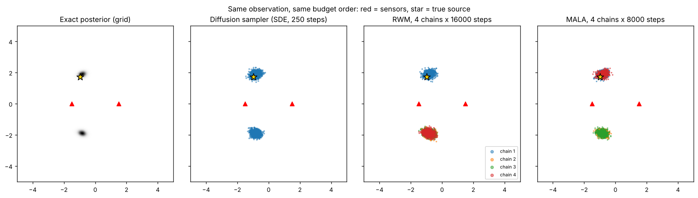
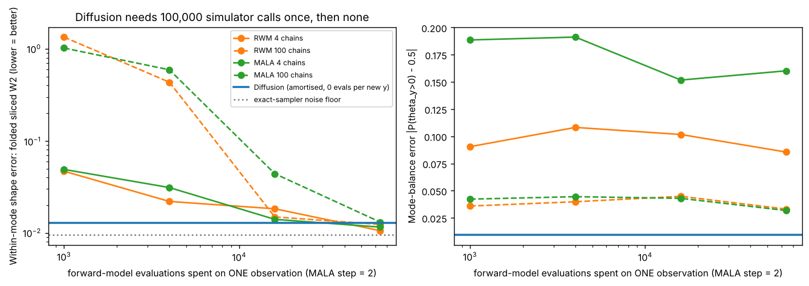
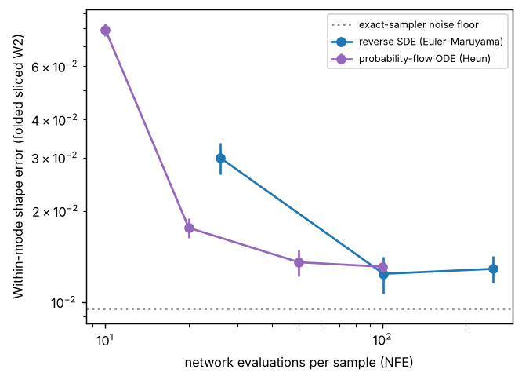
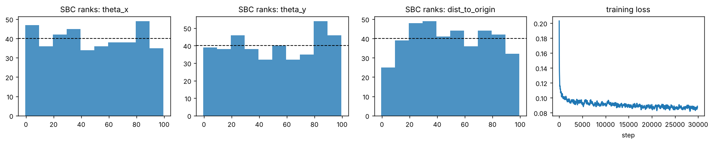

# Amortised diffusion-model posterior sampling vs MCMC on a bimodal inverse problem

A small, fully reproducible study: can a score-based diffusion model, trained once on simulated data, replace
MCMC for Bayesian inference, and where does it help or fail?

## Motivation

Many scientific and decision problems (flood and bushfire modelling, weather prediction, medical imaging,
geophysics) are Bayesian inverse problems: given noisy measurements, infer the unknown cause **and** how
uncertain that inference is. The uncertainty is the point. If two ignition locations are both consistent
with the sensor readings, a search team needs to know there are two candidates, not just one best guess.

Two things make this hard in practice:

1. **Cost.** MCMC needs many forward-model evaluations for every new dataset. When the forward model is a
   simulator or PDE solver, each evaluation can take seconds to minutes, and when measurements keep arriving
   (for example from sensors on a drone) the whole computation has to be repeated.
2. **Multimodality.** Ambiguous data produce posteriors with several separated modes. Samplers that make
   small local moves, such as random-walk Metropolis and MALA, rarely cross the low-probability barrier between
   modes, so they can return a confident but wrong answer unless diagnostics catch it.

Diffusion models offer a possible way out. They learn to turn noise into samples from a distribution, can
represent multimodal laws, and move the cost from repeated sampling to a one-off training run
("amortisation"). That raises concrete questions: how accurate are the resulting posteriors, are the mode weights
right, how many network evaluations does sampling need, and when does the up-front training cost pay off
against MCMC?

This repository is a small controlled study of those questions on a problem where the **exact posterior is
known**, so each claim can be checked against ground truth. It is a first step, not a claim about
high-dimensional or expensive models (see Limitations).

## Problem ("where did the fire start?")

An unknown source location `theta` in the plane (prior `N(0, 2^2 I)`) is observed through two sensors at
`(-1.5, 0)` and `(1.5, 0)`, which report the distance to the source plus Gaussian noise (sd 0.15).
Two sensors cannot tell a source from its mirror image across the line joining them, so the posterior has
**two symmetric modes** separated by a low-probability barrier. This is exactly the setting where MCMC is
known to struggle. Because the problem is 2D, the **exact posterior can be computed on a grid** (561 x 561), so
every method is scored against ground truth.

**Data.** Simulated from the model above (no external dataset): 100,000 `(theta, y)` pairs for training and
12 held-out observations with strongly bimodal posteriors (less than 2% posterior mass near the mirror line).
Simulated data is the right choice here because it makes the exact posterior available for evaluation.

## Methods

* **Diffusion sampler (amortised).** Conditional score model `s(theta_t, t, y)` for a VP-SDE (linear beta schedule),
  trained by denoising score matching (epsilon-prediction), 4x128 SiLU MLP with Fourier time features, Adam with
  cosine decay and weight EMA, 30,000 steps, batch 256. About 97 s on one CPU core. Samples come from the reverse
  SDE (Euler-Maruyama) or the probability-flow ODE (Heun), with a final Tweedie denoising step.
  The network and its backpropagation are written in NumPy (`diffusion_posterior.py`); a PyTorch port is in
  `diffusion_posterior_torch.py` (checked against the NumPy results, see Robustness checks).
* **Random-walk Metropolis (RWM) and MALA**, run from scratch for every observation, chains started from prior draws,
  per-chain step-size tuning towards 0.30 / 0.57 acceptance, first half of each run discarded as burn-in.
  Cost is counted in forward-model evaluations (a MALA step counts as 2 to include the gradient).
* **Metrics** (2000 samples per observation, 12 observations, mean +/- s.e.):
  * *Within-mode shape error*: sliced 2-Wasserstein distance after folding the two mirror modes onto each other.
  * *Mode-balance error*: `|P(theta_y > 0) - 0.5|` (the true value is exactly 0.5 by symmetry).
  * I split the metric in two because plain sliced W2 on a bimodal law is dominated by sampling noise in the
    mode weights (even exact samples scored about 0.27 in a first attempt).
  * Noise floor (2000 exact draws vs exact reference): shape error 0.0095. Mode-balance error from sampling noise
    alone for 2000 draws: about 0.009.

## Results

**Diffusion sampler, accuracy vs network evaluations (NFE)**

| sampler | NFE | shape error | mode-balance error |
|---|---|---|---|
| SDE, 25 steps | 26 | 0.0299 +/- 0.0036 | 0.016 |
| SDE, 100 steps | 101 | 0.0124 +/- 0.0017 | 0.009 |
| SDE, 250 steps | 251 | 0.0129 +/- 0.0013 | 0.009 |
| ODE-Heun, 5 steps | 10 | 0.0793 +/- 0.0036 | 0.011 |
| ODE-Heun, 10 steps | 20 | 0.0176 +/- 0.0013 | 0.012 |
| ODE-Heun, 25 steps | 50 | 0.0135 +/- 0.0014 | 0.013 |
| ODE-Heun, 50 steps | 100 | 0.0131 +/- 0.0007 | 0.010 |

**MCMC vs forward-model evaluations spent on one observation** (shape error | mode-balance error)

| method | 1k | 4k | 16k | 64k |
|---|---|---|---|---|
| RWM, 4 chains | 0.047 \| 0.09 | 0.022 \| 0.11 | 0.018 \| 0.10 | 0.011 \| 0.09 |
| MALA, 4 chains | 0.049 \| 0.19 | 0.031 \| 0.19 | 0.014 \| 0.15 | 0.012 \| 0.16 |
| RWM, 100 chains | 1.34 \| 0.04 | 0.43 \| 0.04 | 0.015 \| 0.05 | 0.012 \| 0.03 |
| MALA, 100 chains | 1.02 \| 0.04 | 0.59 \| 0.05 | 0.044 \| 0.04 | 0.013 \| 0.03 |

**Mixing diagnostics** (4 chains, post burn-in): median R-hat of `theta_y` is 10.3 (RWM) and 7.2 (MALA)
(a converged run gives about 1.0). Only 33% (RWM) and 29% (MALA) of chains ever visit both modes, with 2.6 and 1.4
mode switches per chain on average.

**Calibration** (simulation-based calibration, 400 prior-predictive cases, 99 posterior draws each): rank
distributions of `theta_x`, `theta_y` and `|theta|` are consistent with uniform (KS p = 0.70, 0.23, 0.21).

**Figure 1.** One observation: exact posterior, diffusion samples, and the MCMC chains (each colour is one chain).
RWM and MALA each settle into whichever mode their chains started in.



**Figure 2.** Accuracy against forward-model evaluations spent on one observation. Left: within-mode shape error.
Right: mode-balance error.



**Figure 3.** Diffusion sampler accuracy against network evaluations.



**Figure 4.** Simulation-based calibration rank histograms (flat is good) and the training loss.



## Insights

1. **The clearest win is mode weights, and it is structural.** With few chains, MCMC's mode split is decided by
   which mode each chain happened to start in, so the error does not fall with budget (0.09 to 0.19 from 1k to 64k
   evaluations; the pure-lottery value for 4 chains is 0.19). One hundred prior-initialised chains fix most of
   this (about 0.04, which is just binomial noise, 0.4/sqrt(K)), but matching the diffusion sampler's 0.009 would
   take roughly 2,000 independent chains (back-of-envelope, not run). The diffusion model's 0.009 is exactly what
   2000 perfect draws would give, because its training pairs are independent draws from the joint law, so it learns
   the mode weights from data instead of having to cross a barrier to find them.
2. **Within a mode, MCMC catches up.** At 16k evaluations MALA (4 chains) scores 0.014 +/- 0.002 and RWM
   (100 chains) 0.015 +/- 0.002, statistically level with the diffusion sampler (0.0124 +/- 0.0017). The diffusion
   sampler sits slightly above the exact-sampler floor (0.0095), which hints at a small residual approximation
   error that 12 observations cannot resolve.
3. **Amortisation arithmetic.** The diffusion model cost 100,000 simulator calls once, then none per new
   observation. MCMC needs about 16,000 evaluations per observation to match its within-mode accuracy, so the
   break-even is roughly 6 observations, and sooner if mode weights matter. **This is accounting, not wall-clock:**
   here the forward model is two square roots, MCMC takes well under a second, and the diffusion model needs 97 s
   of training plus about 1 s per 2000-sample observation. The benefit only becomes real when the forward model
   is expensive (PDE solves) or observations keep arriving (streaming sensor data), which this toy does not test.
4. **Sampler choice matters.** A second-order ODE solver reaches near-converged quality at 50 network evaluations
   (0.0135), versus 100 to 250 for Euler-Maruyama on the SDE (0.0124 to 0.0129), and 25 SDE steps are clearly
   worse (0.030). Too few Heun steps fail outright (0.079 at 10 NFE).
5. **Baseline tuning can flatter the new method.** My first MALA baseline used one shared step size per
   observation, which left a minority of prior-initialised chains stuck far from the posterior (mean log-posterior
   about -14 against -3 for the reference) and gave an error of about 0.4. Per-chain step-size adaptation fixed
   it. Results above use the fixed baselines.
6. **R-hat does its job.** It flags the multimodality loudly (7 to 10), whereas the within-mode shape error of a
   stuck chain looks perfectly fine, a reminder that unimodal summaries can hide a wrong answer.

## Robustness checks

Everything above comes from one trained model. To see how much that matters I trained further models on the same
data and scored them on the same 12 fresh test observations (`seed_check.py`):

| training setup | models | shape error: SDE-100 | SDE-250 | ODE-50 |
|---|---|---|---|---|
| He init (the NumPy script's default), different training seeds | 3 | 0.0124 to 0.0140 | 0.0124 to 0.0134 | 0.0128 to 0.0133 |
| PyTorch-default init, different training seeds | 2 | 0.0146 to 0.0165 | 0.0140 to 0.0162 | 0.0150 to 0.0151 |

* Seed-to-seed variation at converged sampler settings is small (a few percent), so the diffusion-vs-MCMC
  comparison above is not an accident of one lucky run.
* Initialisation matters more than the seed. PyTorch's default `nn.Linear` initialisation gave 10 to 20% higher
  error at 30,000 training steps, probably because it trains a little more slowly. A first PyTorch port that used
  the default init landed in that range (0.014 to 0.017), which is how this was found. The PyTorch script now
  uses He init to match. With only 2 to 3 models per row, treat the init effect as suggestive, not established.

### PyTorch port check

The PyTorch version was run on CPU on the same training data and test observations (about 25 s to train, against
about 97 s for the NumPy implementation). Within-mode shape error, noise floor 0.0095:

| sampler | NFE | NumPy (He init) | PyTorch, default init | PyTorch, He init |
|---|---|---|---|---|
| SDE, 25 steps | 26 | 0.0299 | 0.0314 | 0.0272 |
| SDE, 100 steps | 101 | 0.0124 | 0.0142 | 0.0133 |
| SDE, 250 steps | 251 | 0.0129 | 0.0164 | 0.0131 |
| ODE-Heun, 10 steps | 20 | 0.0176 | 0.0190 | 0.0182 |
| ODE-Heun, 25 steps | 50 | 0.0135 | 0.0167 | 0.0138 |
| ODE-Heun, 50 steps | 100 | 0.0131 | 0.0168 | 0.0154 |

With He init the PyTorch port agrees with NumPy to within about 0.001 at three of the four converged settings.
ODE-50 is about 0.002 higher, comparable to the model-to-model variation above, and more steps do not improve it,
so it reflects noise in one trained model rather than a systematic difference. Mode-balance errors (0.005 to
0.014) are all at the level of sampling noise. These are single runs, so differences of this size should not be
over-interpreted.

## Limitations

* Two dimensions, a cheap forward model, exactly symmetric modes and simulated data (so no model misspecification).
  Conclusions about high dimensions or asymmetric modes are not supported by this study.
* The model is only valid for observations inside the training (prior-predictive) range; out-of-range
  observations were not tested.
* 12 test observations; the tables use one trained model (the check above shows how much that can move the
  converged diffusion error: about 0.0124 to 0.0140 across seeds); hyperparameters were not tuned.
* This is **amortised simulation-based inference with a conditional diffusion model**. It is related to, but
  not the same as, diffusion-based samplers that target an unnormalised posterior density directly (score-based
  and Schrodinger-bridge samplers), which need no training data from the model. Do not describe the two as the same.
* Single-core NumPy; MALA counted as 2 evaluations per step.

## Natural next steps

1. A density-based diffusion sampler (no training data; the target known only up to a constant) on the same
   posterior, compared with the amortised model and MCMC. This is much closer to the research direction.
2. Raise the dimension (more unknowns, a 3D source, or a PDE forward model) and see where each method breaks.
3. Add sequential Monte Carlo as a baseline, multiple seeds, and an asymmetric three-sensor variant.

## Reproduce

```
python -m venv .venv && source .venv/bin/activate      # Windows: .venv\Scripts\activate
pip install -r requirements.txt

python diffusion_posterior.py                          # trains (~100 s) and evaluates (~100 s); writes ./results
python diffusion_posterior.py --stage train            # or run the two stages separately;
python diffusion_posterior.py --stage eval             # eval reuses the cached model
python diffusion_posterior.py --quick                  # 1-minute smoke test (undertrained, errors are larger)
```

### PyTorch version

`diffusion_posterior_torch.py` reimplements the model, training loop and samplers in PyTorch and reuses the problem
definition, exact posterior, metrics and plotting code from `diffusion_posterior.py`. Install PyTorch for your
machine from https://pytorch.org/get-started/locally/ (the CPU build is enough for this model), then:

```
python diffusion_posterior_torch.py --steps 3000       # quick look
python diffusion_posterior_torch.py                    # full run
```

It prints the accuracy of each sampler and writes to `./results_torch`:

| output | contents |
|---|---|
| `fig_posteriors.png` | exact posterior vs diffusion samples for one observation |
| `fig_accuracy_vs_nfe.png` | shape error and mode-balance error against network evaluations (SDE vs ODE sampler) |
| `fig_training_loss.png` | training loss curve |
| `results.json` | the numbers, plus device and training time |
| `model.pt` | trained weights |

To see how much a single trained model can move the numbers, repeat with different training seeds (this changes
the network initialisation and minibatches only; the data and test set stay fixed) and separate output folders:

```
python diffusion_posterior_torch.py --train_seed 1 --out results_torch_s1
python diffusion_posterior_torch.py --train_seed 2 --out results_torch_s2
```

The PyTorch script covers the diffusion model only. The MCMC comparison, the cost-versus-accuracy figure and the
calibration check live in `diffusion_posterior.py`.

Results will not match the NumPy run digit for digit (different random number generators), but should be close:
for the 100-step SDE sampler, shape error about 0.012 to 0.014 and mode-balance error about 0.01.

## Files

| file | what it is |
|---|---|
| `diffusion_posterior.py` | the full study in NumPy: problem, exact posterior, diffusion model, MCMC baselines, metrics, figures |
| `diffusion_posterior_torch.py` | PyTorch version of the diffusion model; writes figures and `results.json` to `results_torch/` |
| `seed_check.py` | the training-seed and initialisation check in Robustness checks (run `--stage train` first) |
| `results.json` | numbers behind the tables above |
| `fig*.png` | figures |

## AI assistance

This project was developed with the help of an AI assistant (Claude, by Anthropic), which wrote the initial code. The results in this repository come from running that code.
